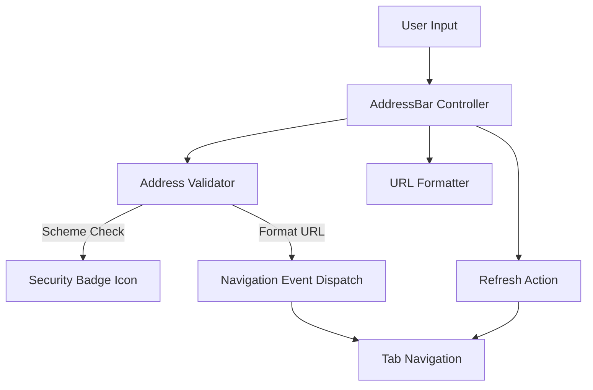

# Address Bar Component

## Purpose

The Address Bar component coordinates user input, destination validation, protocol classification, and navigation event dispatch within the Nous browser shell. It provides real-time security status indication (HTTPS secure, HTTP insecure, internal `about:`, search, or blocked), safe input formatting, and clean display-versus-edit state transitions.

## Dependencies

- DOM primitives (`HTMLInputElement` / contenteditable `HTMLElement`, `SVGElement`).
- URL parsing standard (`URL`).
- Preload context bridge & renderer IPC delegation layer.

## Big-O Complexity

- **Input Validation**: $O(L)$ where $L$ is the length of the input string (regex pattern evaluations and URL parsing).
- **Navigation Event Dispatch**: $O(K)$ where $K$ is the number of registered navigation subscribers.
- **Display Formatting**: $O(L)$ protocol extraction and string slicing.
- **UI State Synchronization**: $O(1)$ class attribute mutations and icon updates.

## Architecture

## Validation & Formatting Pipeline

1. **Input Normalization**:
   - Trims leading and trailing whitespace.
   - Replaces empty inputs with `about:blank`.
2. **Protocol Filtering**:
   - Explicitly blocks unsafe/executable pseudoprotocols (`javascript:`, `data:`, `vbscript:`, `file:`).
   - Allows standard web and internal schemes (`https:`, `http:`, `about:`).
3. **Smart Heuristic Routing**:
   - Local domains (`localhost`, IPv4) automatically default to `http://`.
   - Standard domain names (`example.com`, `github.com/ZenOska`) default to `https://`.
   - Text queries containing spaces or lacking valid host structure are routed to the default search engine (`https://www.google.com/search?q=`).

## Security Invariants

- **Execution Prevention**: The address bar never executes script URLs. Attempting to navigate to `javascript:` URLs is rejected and visually flagged with an error state.
- **Protocol Tamper Guard**: Insecure HTTP destinations are explicitly badged with warning indicators, while secure HTTPS sites display verified padlock badges.
- **Display Decoupling**: When the address bar is not focused, URLs are formatted cleanly for scannability; on focus, the complete editable destination is presented to the user.

## Event Handling

| Trigger            | Action                                                                       |
| ------------------ | ---------------------------------------------------------------------------- |
| `Enter` key        | Validates input, formats destination URL, and dispatches `onNavigate`.       |
| `Escape` key       | Cancels edit, reverts text to active tab URL, and removes focus.             |
| `Focus`            | Enters editing mode, presents full raw URL, and auto-selects all text.       |
| `Blur`             | Exits editing mode, reverts text to display format, and clears error states. |
| `Refresh` button   | Triggers reload of active tab via `onRefresh`.                               |
| `Ctrl+L` / `Cmd+L` | Global shortcut focusing and selecting address bar contents.                 |
