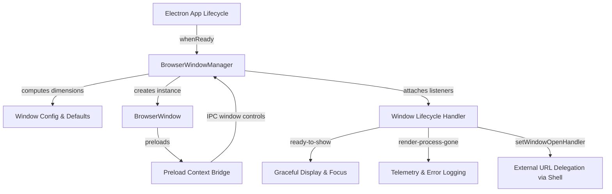

# Browser Window Component

## Purpose

The Browser Window component manages the lifecycle, default dimensions, display configuration, and process boundaries of the primary desktop browser shell window. It encapsulates Electron window instantiation, bounds constraints, cross-platform frame styling, security policies, and IPC window management.

## Dependencies

- `electron`: Native APIs including `BrowserWindow`, `screen`, `shell`, and `ipcMain`.
- Node.js runtime primitives (`node:path`, `node:url`).

## Big-O Complexity

- **Window Instantiation**: $O(1)$ time and $O(1)$ auxiliary memory (bounded single-instance display structures).
- **Dimension Calculation**: $O(1)$ arithmetic constraint checks.
- **Event Attachment & Teardown**: $O(1)$ listener registration across fixed lifecycle channels.
- **IPC Handler Dispatch**: $O(1)$ direct hash-map lookups in Electron IPC dispatch table.

## Architecture

## Dimensions & Defaults

| Property           | Default Value | Notes                                           |
| ------------------ | ------------- | ----------------------------------------------- |
| Initial Width      | 1400 px       | Clamped to primary display work area            |
| Initial Height     | 900 px        | Clamped to primary display work area            |
| Minimum Width      | 800 px        | Enforces functional layout density              |
| Minimum Height     | 600 px        | Enforces functional layout density              |
| Background Color   | `#0d0f12`     | Prevents white flash before CSS load            |
| Title Bar Style    | `hidden`      | Custom client chrome with traffic light styling |
| Auto-Hide Menu Bar | `true`        | Streamlined cross-platform presentation         |

## Security & WebPreferences Constraints

The window configuration explicitly guarantees sandbox boundaries:

- `contextIsolation: true`
- `nodeIntegration: false`
- `sandbox: true`
- `webSecurity: true`
- `allowRunningInsecureContent: false`
- `experimentalFeatures: false`
- Child window popups intercepted and denied via `setWindowOpenHandler`.

## Lifecycle Handlers

| Lifecycle Event               | Action Taken                                                          |
| ----------------------------- | --------------------------------------------------------------------- |
| `ready-to-show`               | Reveals window without render flicker; activates focus in development |
| `focus` / `blur`              | Propagates active focus states                                        |
| `maximize` / `unmaximize`     | Tracks maximization state for client-side window control UI           |
| `minimize` / `restore`        | Handles minimize and taskbar restoration                              |
| `resize` / `move`             | Emits updated window bounds                                           |
| `unresponsive` / `responsive` | Logs warning telemetry and detects UI thread recovery                 |
| `render-process-gone`         | Captures termination reasons (`crashed`, `killed`, `oom`)             |
| `closed`                      | Cleans up event listeners and window references                       |
