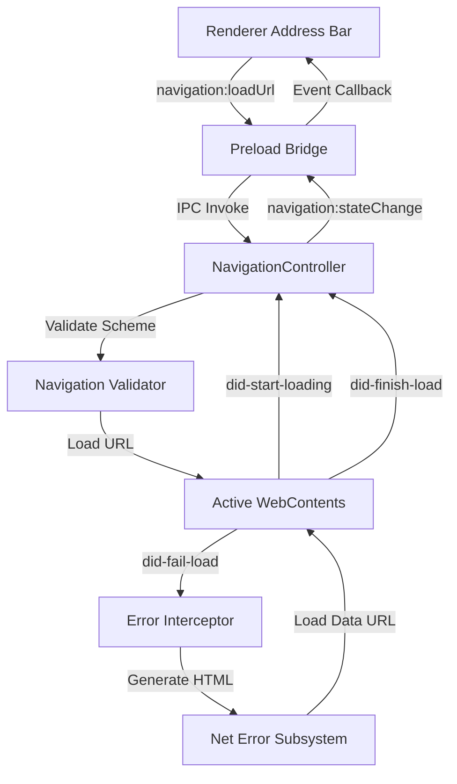

# Navigation Pipeline & Error Pages

## Purpose

The Navigation Pipeline coordinates destination URL validation, WebContents request lifecycle management, and graceful error page generation for the Nous desktop browser shell. It bridges the renderer process chrome (address bar and tabs) with privileged Electron main process webContents operations, suppressing raw crash dialogs and rendering user-friendly diagnostic screens on network or DNS failures.

## Dependencies

- Electron `WebContents` and `ipcMain` primitives.
- Standard WHATWG `URL` parsing specification.
- Preload context bridge (`ElectronAPI.navigation`).
- Renderer IPC client (`RendererIpcClient`).

## Big-O Complexity

- **URL Protocol Validation**: $O(L)$ where $L$ is the length of the input URL string.
- **Error Page HTML Generation**: $O(U)$ where $U$ is the length of the diagnostic message and failed URL (single-pass HTML escaping and template interpolation).
- **Lifecycle Event Dispatch**: $O(S)$ where $S$ is the number of subscribed listeners across IPC channels.
- **State Query (`getState`)**: $O(1)$ constant time shallow copy.
- **Session History Traversal (`goBack`)**: $O(1)$ constant time history pop and capability toggle (see [history.md](file:///c:/Users/USER/Desktop/Extras/ZenOska/nous-oska/docs/components/history.md)).

## Architecture

## Protocol Enforcement Pipeline

1. **Permitted Schemes**:
   - `https:` (secure external destination)
   - `http:` (insecure external destination / local server)
   - `about:` (restricted to `about:blank` and `about:neterror`)
2. **Disallowed / Blocked Schemes**:
   - Executable script protocols (`javascript:`, `vbscript:`)
   - Unhandled local filesystem references (`file:`)
   - Arbitrary data scheme injections (`data:`)
   - Unsupported browser internals (`about:config`, `about:flags`, `chrome:`)

## Error Recovery Matrix

| Chromium Error Code | Identification              | User Diagnostic Feedback                                                                            | Recovery Action                                       |
| ------------------- | --------------------------- | --------------------------------------------------------------------------------------------------- | ----------------------------------------------------- |
| `-105`              | `ERR_NAME_NOT_RESOLVED`     | "Server IP address could not be found"                                                              | Verify DNS settings & hostname spelling; Retry button |
| `-106`              | `ERR_INTERNET_DISCONNECTED` | "You are currently offline"                                                                         | Check network cables/WiFi; Retry button               |
| `-102`              | `ERR_CONNECTION_REFUSED`    | "Site refused to connect"                                                                           | Verify server availability and port; Retry button     |
| `-200` to `-299`    | `ERR_CERT_*`                | "A secure connection could not be established because the site certificate is invalid or untrusted" | Security warning display; Retry button                |
| Fallback            | `ERR_NETWORK_ERROR`         | Human-readable description with technical error code                                                | Reload current target URL                             |

## Security Invariants

- **Execution Immunity**: The main navigation pipeline strictly rejects any scheme outside of `https:`, `http:`, and permitted `about:` endpoints. Script URLs never reach `webContents.loadURL`.
- **Cross-Site Scripting Guard**: All error page injections (failed URLs, error descriptions) pass through strict character escaping (`&`, `<`, `>`, `"`, `'`) before template assembly.
- **Frame Isolation**: Subframe load failures (`isMainFrame === false`) and intentional user cancellations (`ERR_ABORTED: -3`) are ignored and will not disrupt active top-level page state.
- **Contract Sandboxing**: Renderer code interacts exclusively through strictly typed `navigation:loadUrl` and `navigation:getState` channels. Direct WebContents manipulation is prohibited.
