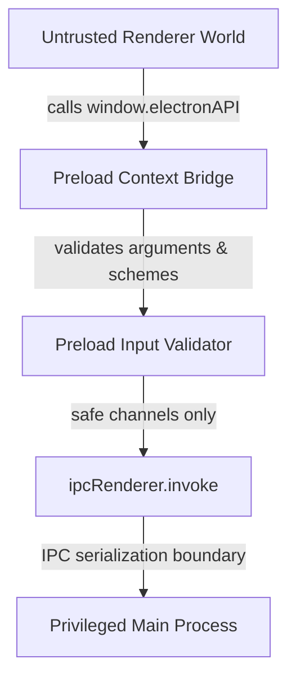

# Preload Component

## Purpose

The Preload component acts as the trusted, secure bridge between the privileged Electron main process and the untrusted Chromium renderer world. It exposes a minimal, strictly typed, and frozen API surface (`window.electronAPI`) across the `contextBridge` boundary, preventing direct access to Node.js primitives or arbitrary IPC channels.

## Dependencies

- `electron`: Native `contextBridge` and `ipcRenderer` APIs.
- TypeScript shared contracts (`src/preload/types.ts`).

## Big-O Complexity

- **Bridge Instantiation**: $O(1)$ object construction and namespace freezing.
- **IPC Dispatch**: $O(1)$ invocation passing serialized arguments through Electron IPC.
- **URL Validation**: $O(L)$ protocol parsing and set lookup where $L$ is input string length.

## Architecture

## Security Invariants & Guarantees

1. **No Node.js Leakage**: `require`, `process`, `Buffer`, and Electron internal classes are never exposed to `window`.
2. **Frozen Namespaces**: The root `electronAPI` object and all nested namespaces (`app`, `platform`, `shell`, `window`) are deeply frozen with `Object.freeze` to prevent prototype tampering in the renderer.
3. **No Arbitrary IPC**: Neither `ipcRenderer.send`, `ipcRenderer.on`, nor generic channel selection is accessible to renderer scripts.
4. **Pre-Flight Argument Validation**: Methods accepting external inputs (such as `shell.openExternal`) validate protocols before dispatching IPC invocations to the main process, dropping disallowed schemes (`javascript:`, `data:`, `file:`).

## Exposed Channel Matrix

| Namespace  | Method              | IPC Channel             | Parameters    | Return Type                    |
| ---------- | ------------------- | ----------------------- | ------------- | ------------------------------ |
| `app`      | `getVersion()`      | `app:getVersion`        | None          | `Promise<string>`              |
| `app`      | `getName()`         | `app:getName`           | None          | `Promise<string>`              |
| `platform` | `get()`             | `platform:get`          | None          | `Promise<string>`              |
| `shell`    | `openExternal(url)` | `shell:openExternal`    | `url: string` | `Promise<void>`                |
| `window`   | `minimize()`        | `window:minimize`       | None          | `Promise<void>`                |
| `window`   | `maximize()`        | `window:maximize`       | None          | `Promise<void>`                |
| `window`   | `unmaximize()`      | `window:unmaximize`     | None          | `Promise<void>`                |
| `window`   | `toggleMaximize()`  | `window:toggleMaximize` | None          | `Promise<void>`                |
| `window`   | `close()`           | `window:close`          | None          | `Promise<void>`                |
| `window`   | `isMaximized()`     | `window:isMaximized`    | None          | `Promise<boolean>`             |
| `window`   | `getState()`        | `window:getState`       | None          | `Promise<WindowState \| null>` |
