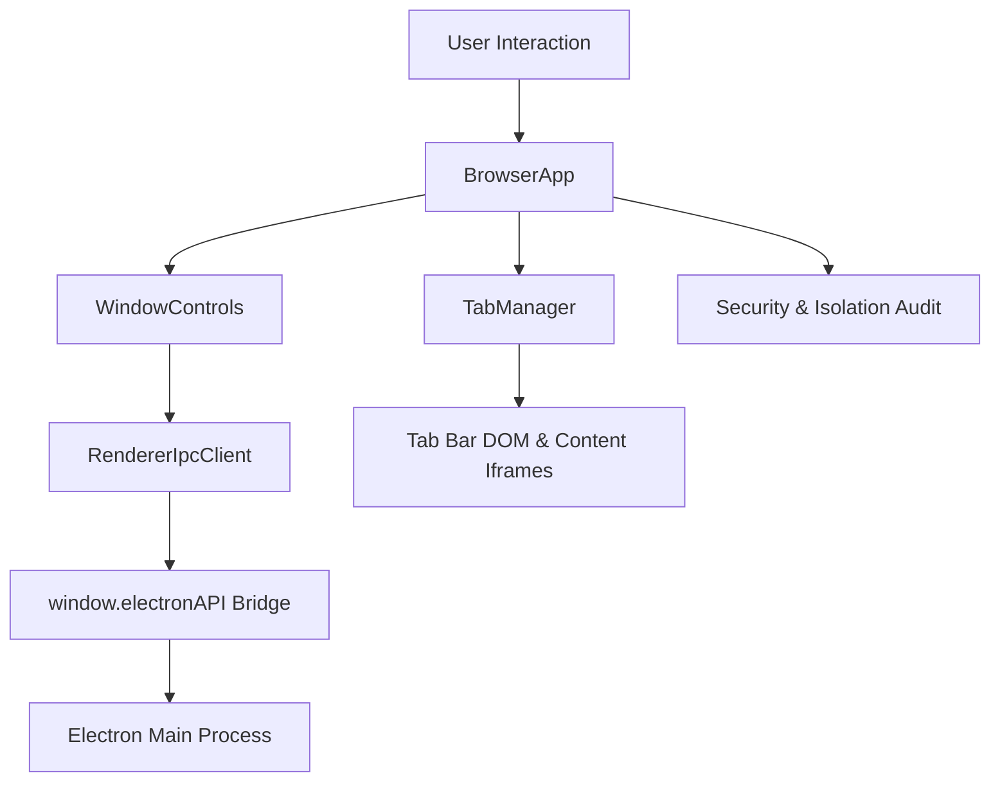

# Renderer Component

## Purpose

The Renderer component represents the untrusted presentation layer of the Nous browser shell. It drives browser chrome rendering (tabs, toolbar, navigation bar, window controls, and new-tab dashboard), connects securely to the main process via an isolated IPC client bridge, and enforces runtime context isolation invariants to prevent privilege escalation from web content.

## Dependencies

- DOM API and Browser Window context.
- Preload context bridge interface (`window.electronAPI`).
- Node.js runtime primitives are explicitly **prohibited** from being accessed in this layer.

## Big-O Complexity

- **Tab Creation & Switch**: $O(1)$ operations with direct key lookup in map.
- **Tab Removal**: $O(1)$ removal and $O(N)$ index-to-tab fallback where $N$ is the active tab count.
- **URL Sanitization & Validation**: $O(L)$ where $L$ is length of the URL/input string.
- **IPC Dispatch**: $O(1)$ asynchronous invocation over Electron's serialized IPC bridge.

## Architecture

## Security & Context Isolation Guarantees

The renderer layer strictly verifies and maintains the following security invariants:

1. **Context Isolation**: `window.electronAPI` is exposed through `contextBridge.exposeInMainWorld`, ensuring renderer script execution runs in an isolated V8 world.
2. **Node Integration Disabled**: Direct Node.js globals (`require`, `process`, `Buffer`, `__dirname`, `__filename`) are verified absent during renderer bootstrap.
3. **Restricted IPC Surface**: The renderer only accesses deliberately exposed, typed methods for app telemetry, platform query, external link delegation, and window controls. Arbitrary IPC channel registration (`ipcRenderer.send`, `ipcRenderer.on`) is completely inaccessible.
4. **Protocol Sanitization**: All address bar inputs and external link delegations undergo strict scheme validation; executable and dangerous schemes (`javascript:`, `data:`, `file:`) are strictly intercepted and blocked.
