# Nous Roadmap & MVP Specification

This document outlines the strategic roadmap, Minimum Viable Product (MVP) boundaries, and milestone division across all 10 phases of the **Nous Desktop Web Browser**.

Detailed technical specifications for every phase item are cataloged in the [Issues Index](../issues/README.md).

---

## MVP Boundary & Phased Strategy

The Minimum Viable Product (MVP) targets a dependable, production-ready desktop browser capable of high-performance web navigation, strict context sandboxing, and modern multi-tab ergonomics:

- **Core MVP**: **Phase 1 (Browser Shell)** + **Phase 2 (Tab System)**
- **Extended MVP**: **Phase 3 (Browser Data: Persistent History & Bookmarks)**

```mermaid
graph LR
    P0["Phase 0: Foundation (Done)"] --> P1["Phase 1: Browser Shell (Active MVP)"]
    P1 --> P2["Phase 2: Tab System (MVP Part 2)"]
    P2 --> P3["Phase 3: Browser Data"]
    P3 --> P4["Phase 4: Modern UX"]
    P4 --> P5["Phase 5: Privacy & Security"]
    P5 --> P6["Phase 6: Advanced Workspaces"]
    P6 --> P7["Phase 7: AI Intelligence"]
    P7 --> P8["Phase 8: Hardening & Testing"]
    P8 --> P9["Phase 9: Production Release"]
```

---

## Milestone & Issue Mapping

| Milestone        | Phase Title                                                                                       | Status               | Issues                                                                                                                                                        |
| ---------------- | ------------------------------------------------------------------------------------------------- | -------------------- | ------------------------------------------------------------------------------------------------------------------------------------------------------------- |
| **Milestone 1**  | [Phase 0: Foundation](https://github.com/ZenOska/Nous-Oska/milestone/1)                           | **Completed**        | [#1](../issues/01-phase-0-set-up-repository-structure-and-development-workflow.md)                                                                            |
| **Milestone 2**  | [Phase 1: Browser Shell (MVP)](https://github.com/ZenOska/Nous-Oska/milestone/2)                  | **In Progress**      | [#3](../issues/03-browser-shell-electron-application-runtime-main-process.md) through [#12](../issues/12-browser-shell-tab-model-lifecycle-view-isolation.md) |
| **Milestone 3**  | [Phase 2: Tab System (MVP)](https://github.com/ZenOska/Nous-Oska/milestone/3)                     | **Planned / Active** | [#20](../issues/20-tab-system-multiple-tabs.md) through [#26](../issues/26-tab-system-keyboard-shortcuts.md)                                                  |
| **Milestone 4**  | [Phase 3: Browser Data](https://github.com/ZenOska/Nous-Oska/milestone/4)                         | **Planned**          | [#27](../issues/27-browser-data-history.md) through [#31](../issues/31-browser-data-preferences.md)                                                           |
| **Milestone 5**  | [Phase 4: Modern UX & Customization](https://github.com/ZenOska/Nous-Oska/milestone/5)            | **Planned**          | [#32](../issues/32-ux-new-tab-page.md) through [#36](../issues/36-ux-customization.md)                                                                        |
| **Milestone 6**  | [Phase 5: Privacy & Security Hardening](https://github.com/ZenOska/Nous-Oska/milestone/6)         | **Planned**          | [#37](../issues/37-privacy-security-private-browsing.md) through [#42](../issues/42-privacy-security-privacy-controls.md)                                     |
| **Milestone 7**  | [Phase 6: Advanced Workspace & Productivity](https://github.com/ZenOska/Nous-Oska/milestone/7)    | **Planned**          | [#43](../issues/43-advanced-browser-workspaces.md) through [#47](../issues/47-advanced-browser-session-manager.md)                                            |
| **Milestone 8**  | [Phase 7: AI & Semantic Intelligence](https://github.com/ZenOska/Nous-Oska/milestone/8)           | **Planned**          | [#48](../issues/48-ai-sidebar.md) through [#52](../issues/52-ai-local-llm-support.md)                                                                         |
| **Milestone 9**  | [Phase 8: Hardening & Performance Optimization](https://github.com/ZenOska/Nous-Oska/milestone/9) | **Planned**          | [#53](../issues/53-testing-optimization-unit-tests.md) through [#57](../issues/57-testing-optimization-performance-optimization.md)                           |
| **Milestone 10** | [Phase 9: Production Distribution & Release](https://github.com/ZenOska/Nous-Oska/milestone/10)   | **Planned**          | [#58](../issues/58-release-windows.md) through [#63](../issues/63-release-pipeline.md)                                                                        |

---

## Phase Breakdowns

### Phase 0 — Foundation _(Milestone 1: Completed)_

- [Repository Setup & Workflow](../issues/01-phase-0-set-up-repository-structure-and-development-workflow.md)

### Phase 1 — Browser Shell _(Milestone 2: MVP Part 1)_

- [Electron Application Runtime & Main Process](../issues/03-browser-shell-electron-application-runtime-main-process.md) (Closed)
- [Browser Window & Lifecycle Management](../issues/04-browser-shell-browser-window-lifecycle-management.md) (Closed)
- [Renderer Process & DOM Structure](../issues/05-browser-shell-renderer.md) (Closed)
- [Preload Script & Secure Context Bridge](../issues/06-browser-shell-preload-script-secure-context-bridge.md) (Closed)
- [Address Bar Controller & Security Indicator](../issues/07-browser-shell-address-bar-controller-security-indicator.md) (Closed)
- [URL Navigation Pipeline & Error Pages](../issues/08-browser-shell-url-navigation-pipeline-error-pages.md) (Closed)
- [Back Navigation & History State Tracker](../issues/09-browser-shell-back-navigation-history-state-tracker.md) (Closed)
- [Forward Navigation & Stack Branching](../issues/10-browser-shell-forward-navigation-stack-branching.md) (Open)
- [Page Reload, Cache Bypass & Stop Navigation](../issues/11-browser-shell-page-reload-cache-bypass-stop-navigation.md) (Open)
- [Tab Model, Lifecycle & View Isolation](../issues/12-browser-shell-tab-model-lifecycle-view-isolation.md) (Open)

### Phase 2 — Tab System _(Milestone 3: MVP Part 2)_

- [Multiple Tabs](../issues/20-tab-system-multiple-tabs.md) (Open)
- [Tab Switching](../issues/21-tab-system-tab-switching.md) (Open)
- [Tab Closing](../issues/22-tab-system-tab-closing.md)
- [Tab Titles](../issues/23-tab-system-tab-titles.md)
- [Favicons](../issues/24-tab-system-favicons.md)
- [Loading Indicators](../issues/25-tab-system-loading-indicators.md)
- [Keyboard Shortcuts](../issues/26-tab-system-keyboard-shortcuts.md)

### Phase 3 — Browser Data _(Milestone 4)_

- [History](../issues/27-browser-data-history.md)
- [Bookmarks](../issues/28-browser-data-bookmarks.md)
- [Downloads](../issues/29-browser-data-downloads.md)
- [Sessions](../issues/30-browser-data-sessions.md)
- [Preferences](../issues/31-browser-data-preferences.md)

### Phase 4 — Modern UX & Customization _(Milestone 5)_

- [New Tab Page](../issues/32-ux-new-tab-page.md)
- [Settings](../issues/33-ux-settings.md)
- [Themes](../issues/34-ux-themes.md)
- [Context Menus](../issues/35-ux-context-menus.md)
- [Customization](../issues/36-ux-customization.md)

### Phase 5 — Privacy & Security _(Milestone 6)_

- [Private Browsing](../issues/37-privacy-security-private-browsing.md)
- [Permissions](../issues/38-privacy-security-permissions.md)
- [Cookies](../issues/39-privacy-security-cookies.md)
- [Storage Controls](../issues/40-privacy-security-storage-controls.md)
- [Security Indicators](../issues/41-privacy-security-security-indicators.md)
- [Privacy Controls](../issues/42-privacy-security-privacy-controls.md)

### Phase 6 — Advanced Browser _(Milestone 7)_

- [Workspaces](../issues/43-advanced-browser-workspaces.md)
- [Tab Groups](../issues/44-advanced-browser-tab-groups.md)
- [Split View](../issues/45-advanced-browser-split-view.md)
- [Reading Mode](../issues/46-advanced-browser-reading-mode.md)
- [Session Manager](../issues/47-advanced-browser-session-manager.md)

### Phase 7 — AI _(Milestone 8)_

- [AI Sidebar](../issues/48-ai-sidebar.md)
- [Page Summarization](../issues/49-ai-page-summarization.md)
- [Page Q&A](../issues/50-ai-page-q-a.md)
- [Smart Search](../issues/51-ai-smart-search.md)
- [Local LLM Support](../issues/52-ai-local-llm-support.md)

### Phase 8 — Testing & Optimization _(Milestone 9)_

- [Unit Tests](../issues/53-testing-optimization-unit-tests.md)
- [Integration Tests](../issues/54-testing-optimization-integration-tests.md)
- [End-to-End Tests](../issues/55-testing-optimization-end-to-end-tests.md)
- [Security Testing](../issues/56-testing-optimization-security-testing.md)
- [Performance Optimization](../issues/57-testing-optimization-performance-optimization.md)

### Phase 9 — Release _(Milestone 10)_

- [Windows Distribution](../issues/58-release-windows.md)
- [Linux Distribution](../issues/59-release-linux.md)
- [macOS Distribution](../issues/60-release-macos.md)
- [Installers](../issues/61-release-installers.md)
- [Auto Updates](../issues/62-release-auto-updates.md)
- [Release Pipeline](../issues/63-release-pipeline.md)

<!-- # Nous Roadmap

## Phase 0 — Foundation

- Repository setup
- Architecture
- Development environment
- Git workflow
- CI
- Documentation

## Phase 1 — Browser Shell

- Electron application
- Browser window
- Renderer
- Preload
- Address bar
- URL navigation
- Back
- Forward
- Reload
- New tab

## Phase 2 — Tab System

- Multiple tabs
- Tab switching
- Tab closing
- Tab titles
- Favicons
- Loading indicators
- Keyboard shortcuts

## Phase 3 — Browser Data

- History
- Bookmarks
- Downloads
- Sessions
- Preferences

## Phase 4 — UX

- New tab page
- Settings
- Themes
- Context menus
- Customization

## Phase 5 — Privacy & Security

- Private browsing
- Permissions
- Cookies
- Storage controls
- Security indicators
- Privacy controls

## Phase 6 — Advanced Browser

- Workspaces
- Tab groups
- Split view
- Reading mode
- Session manager

## Phase 7 — AI

- AI sidebar
- Page summarization
- Page Q&A
- Smart search
- Local LLM support

## Phase 8 — Testing & Optimization

- Unit tests
- Integration tests
- End-to-end tests
- Security testing
- Performance optimization

## Phase 9 — Release

- Windows
- Linux
- macOS
- Installers
- Auto updates
- Release pipeline -->
